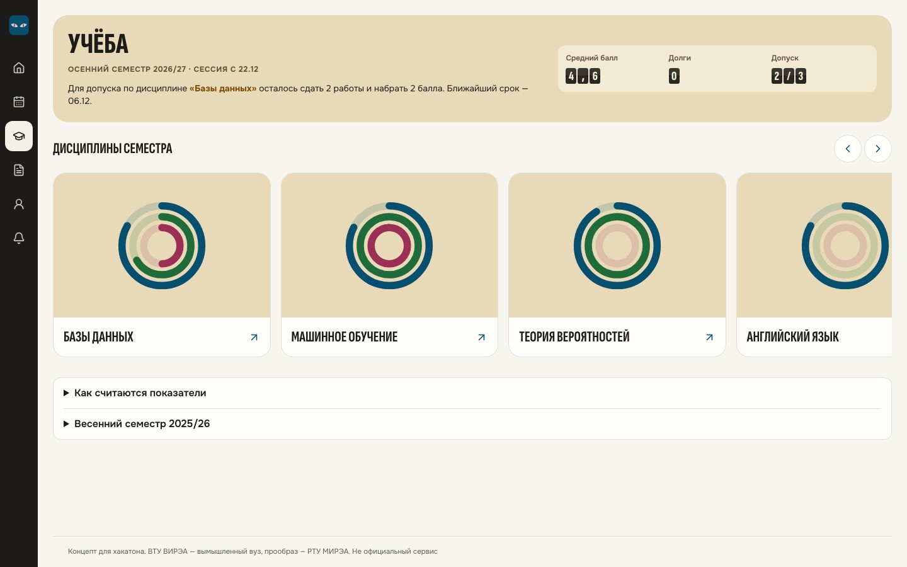
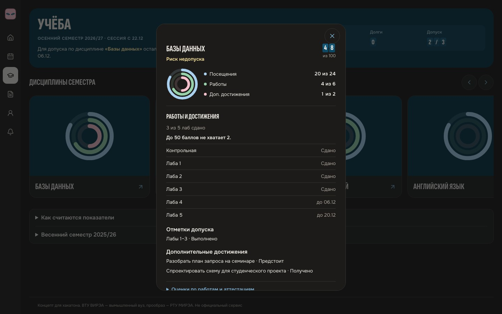
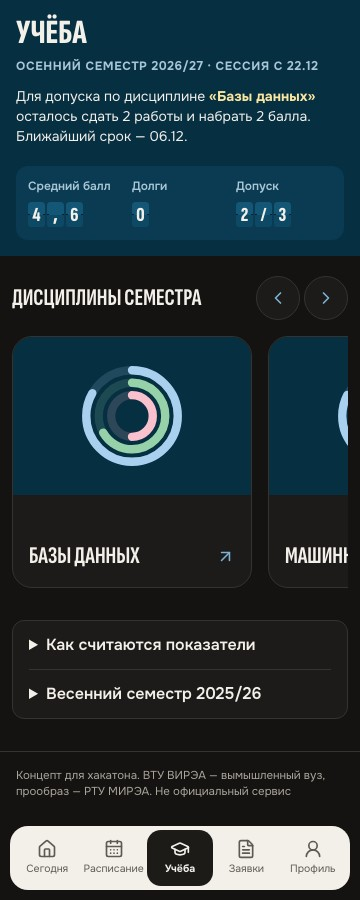

# Карточки дисциплин с кольцами активности в разделе «Учёба»

- **Дата и время:** 2026-11-21 22:30 МСК
- **Инструмент:** Codex (Алёна)
- **Кто ставил задачу:** Алёна
- **Этап плана:** 4 Must, 6 Проверка
- **Требования PRD:** G1, G2, G3, NF1

## Задача

«Вместо изображения поставь как раз эти кольца активностей … а при нажатии открывается (через анимацию) всплывающее окно со всеми подробностями».

## Что сделал ИИ

Оставил дисциплины внутри «Учёбы». Карусель листается пальцем, перетаскиванием мышью, кнопками и клавиатурой. На обложке предмета видны название и три кольца. Окно раскрывается с анимацией, содержит расшифровку колец, сроки работ, сведения о допуске, оценки и достижения. При уменьшенном движении окно появляется сразу.

Добавил миграцию для отметок посещения и дополнительных целей. Кольца рассчитываются из персональных записей по дисциплине за семестр. Во временной базе проверены миграции, сценарии кабинета и отображение в двух темах при ширине 320–1440 px. Проверен возврат фокуса на карточку после закрытия и отсутствие чужих достижений в карточке.

## Что проверил и поправил человек

Алёна отменила отдельный раздел «Предметы», выбрала карусель и уточнила, что подписи и подробности нужны внутри окна. Просмотр результата Алёной предстоит.

## Ошибки ИИ

Не было.

## Скриншоты

