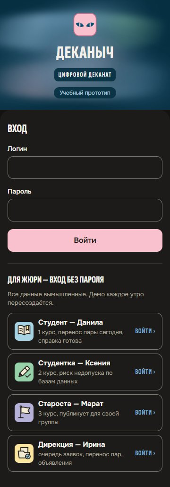
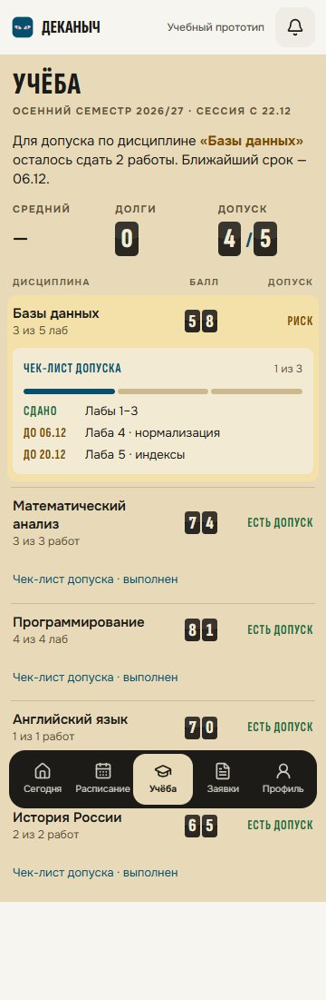
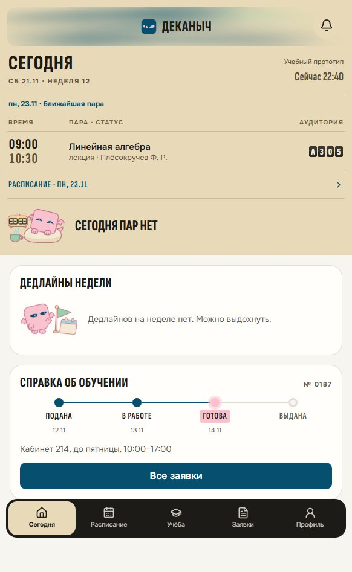
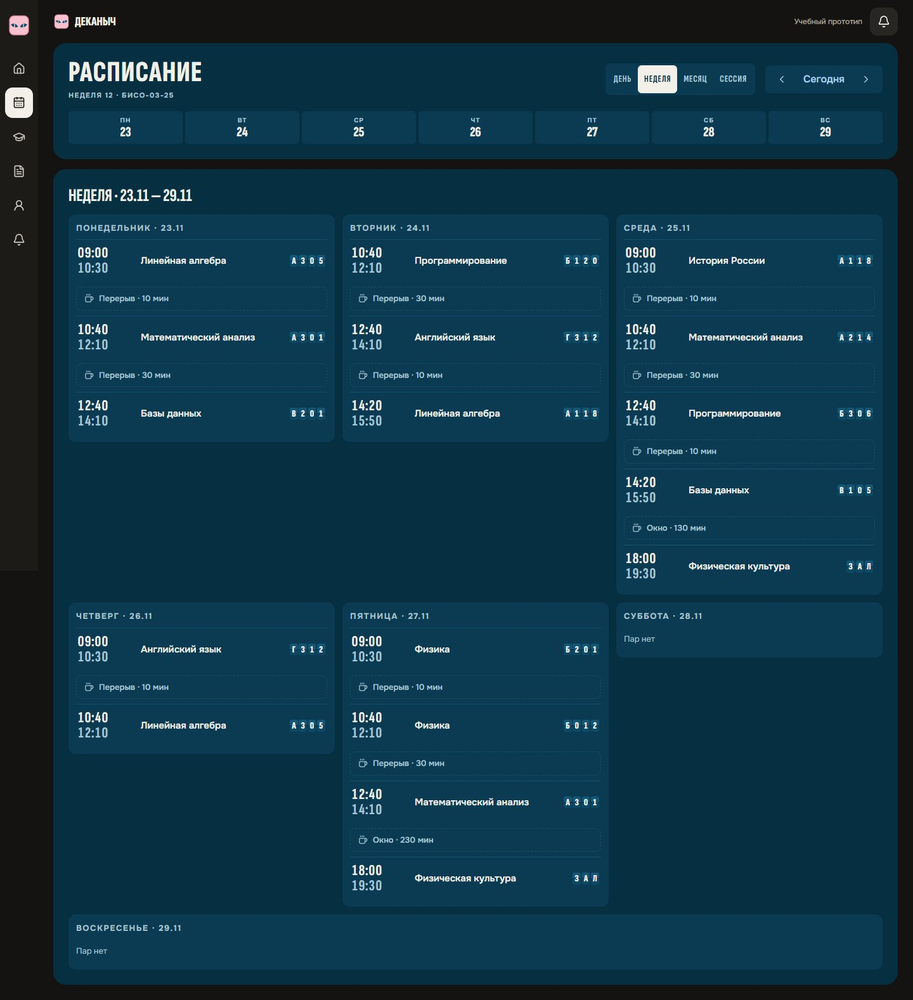
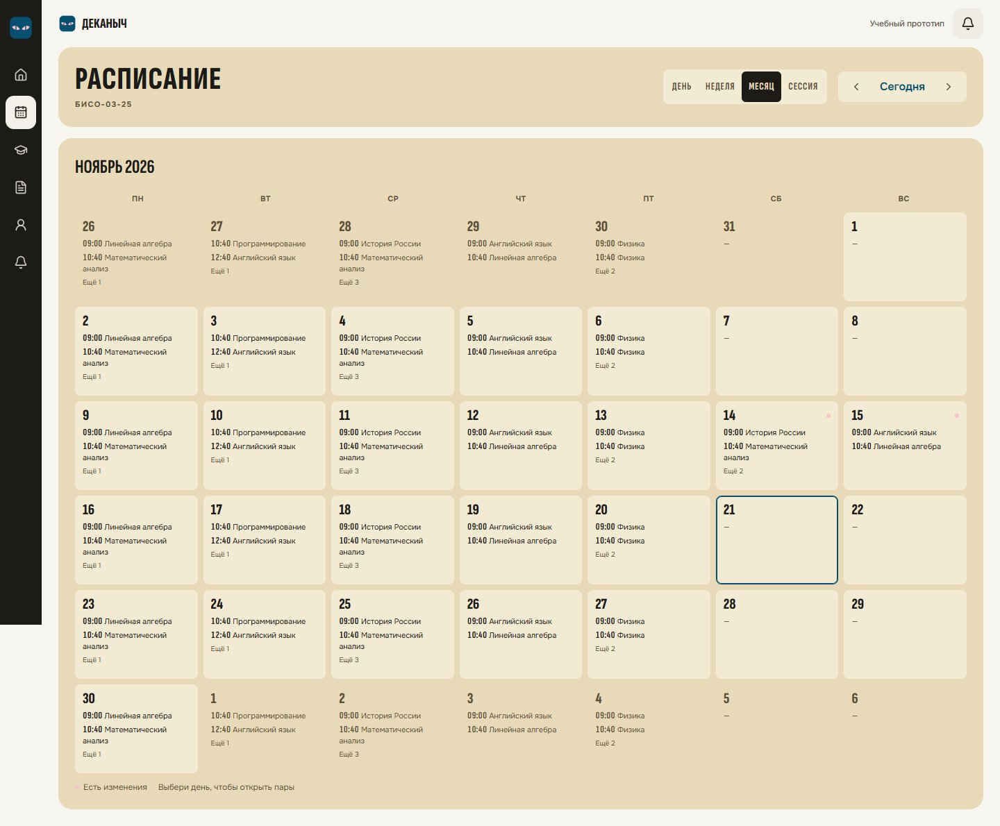

# Полные названия предметов и дизайн по учебным приложениям

- **Дата и время:** 2026-11-21 22:46 МСК
- **Инструмент:** Codex (напарник)
- **Кто ставил задачу:** напарник
- **Этап плана:** 6 Проверка
- **Требования PRD:** R2, G2, T1, X1, NF1, NF3, NF8

## Задача

> Убрать название вуза на входе, писать названия предметов без сокращений.
> «Просмотри похожие приложения и доработай наш дизайн».
> После остановки автоматической проверки разрешений: «Продолжай».

## Что сделал ИИ

- Убрал название вуза с входа, из метаданных и названия PWA. На входе остаются бренд, «Цифровой деканат» и метка учебного прототипа. Данные вымышленного студенческого билета не переименовывались.
- Во всех структурированных учебных представлениях используется Subject.name: день, неделя, месяц, учёба и новые уведомления об изменении пары. Убрал subjectShort из LessonView, обновил демо-подписи будущих сидов. Схема и миграции не менялись, старые сообщения и база пользователя не переписывались.
- Названия дисциплин перевёл на Onest 600 с обычным регистром и переносами. Время, числа, бренд и заголовки разделов сохраняют Sofia. В превью месяца длинные названия не обрезаются многоточием.
- Рассмотрел официальные публичные примеры MyStudyLife и Power Planner, описание Moodle App; источники, наблюдения и принятые изменения — в [обзоре](../../research/ui-references-2026-11-21.md). Чужие изображения, шрифты и код в приложение не добавлялись.
- На главной сделал компактные пустые состояния со своими иллюстрациями, отдельные карточки дедлайнов, оценок и заявки. В недельном виде карточки не растягиваются по высоте соседнего длинного дня. Порядок блоков T1, палитра, логотип и анимации сохранены.
- Новые функции из чужих приложений не добавлялись. Для них по-прежнему нужен отдельный выбор команды.
- Прошли production-сборка, ESLint, проверка TypeScript, 18 модульных и полный повторный прогон 30 браузерных тестов. Проверены полные названия, отсутствие вуза на входе, заявки, 404 для чужого пользователя, сессия своей группы, календарь, чтение ленты и навигация. Адаптация — 320–1920 px.
- Итоговые экраны сняты и просмотрены на 360, 582 и 1440 px в обеих темах. Локальное приложение обновлено с сохранением базы пользователя. Изменения подготовлены в PR #81; владелец визуального ревью — Алёна.
- Первый локальный запуск временно остановила внешняя автоматическая проверка разрешений из-за лимита использования. После сообщения пользователя та же команда прошла проверку и была выполнена; ограничение не обходилось.

## Что проверил и поправил человек

Пользователь отметил название вуза, попросил полные дисциплины и исследование похожих приложений. Окончательное визуальное ревью предстоит.

## Ошибки ИИ

- Адаптивный тест измерял соседние карточки двумя асинхронными вызовами во время появления общего блока → на 1366 px координаты отличались на 0,0013 px → оба прямоугольника теперь измеряются одним evaluateAll в одном кадре, строгое сравнение сохранено → геометрию анимированных элементов сравнивать по одному кадру. Повторно прошли все 30 сценариев.

## Скриншоты

