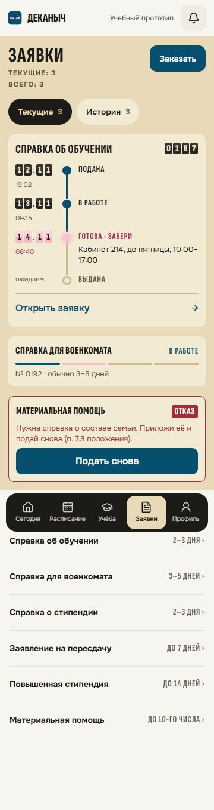
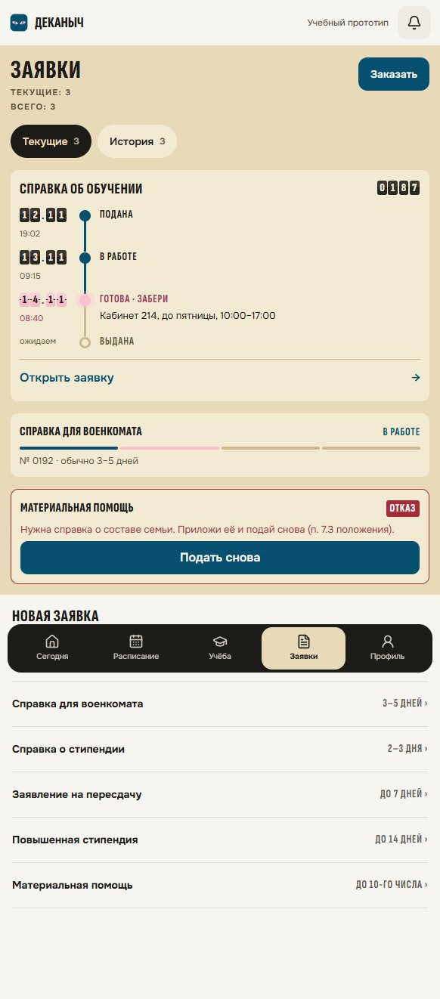

# Счётчики заявок на отдельных строках

- **Дата и время:** 2026-11-21 22:53 МСК
- **Инструмент:** Codex (напарник)
- **Кто ставил задачу:** напарник
- **Этап плана:** 6 Проверка
- **Требования PRD:** A4, NF1

## Задача

> «Текущие: 3 · Всего: 3» — «пиши их не в одной строке».

## Что сделал ИИ

- Разместил счётчики «Текущие» и «Всего» в двух строках с небольшим промежутком в шапке заявок.
- Production-сборка с проверкой TypeScript прошла. В браузере проверено, что счётчики находятся друг под другом на 360 и 582 px; горизонтальной прокрутки нет. Итоговые JPEG просмотрены.
- Локальное приложение обновлено, правка подготовлена в PR #81. Владелец визуального ревью — Алёна.

## Что проверил и поправил человек

Пользователь указал строку счётчиков в браузере. Окончательное визуальное ревью предстоит.

## Ошибки ИИ

Не было.

## Скриншоты

