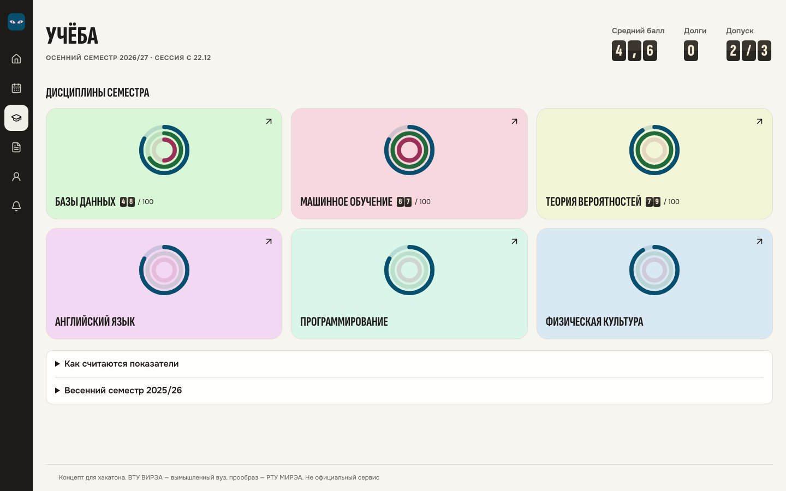
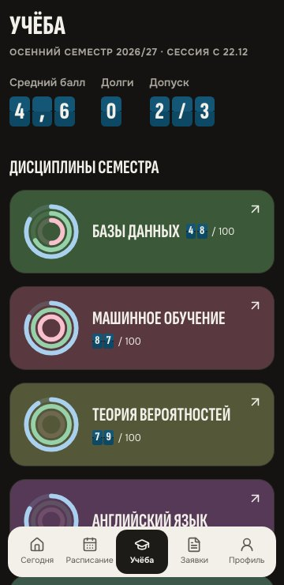
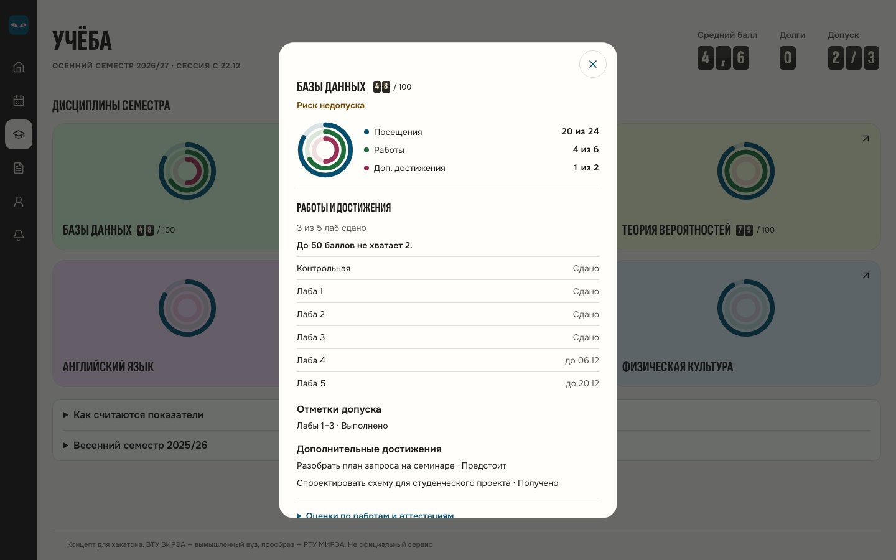

# Сетка дисциплин и сводка успеваемости

- **Дата и время:** 2026-11-21 23:05 МСК
- **Инструмент:** Codex (Алёна)
- **Кто ставил задачу:** Алёна
- **Этап плана:** 6 Проверка
- **Требования PRD:** G1, G2, G3, NF1

## Задача

«Убери прокрутку карточек, выстрой их все как таблицу с прокруткой вниз всей страницы». Алёна также попросила перенести рейтинг к названию, убрать фразу из шапки и увеличить сводные показатели.

## Что сделал ИИ

В разделе «Учёба» все дисциплины расположены рядами. Каждая получила свой оттенок, который сохраняется при изменении порядка по допуску. Рейтинг виден рядом с названием на карточке и в окне подробностей. У предмета без опубликованной ведомости рейтинг скрыт. Убрана подложка шапки, цифры увеличены с 20 до 30 пикселей. Сроки и работы доступны в окне дисциплины.

Проверена сборка приложения. В Chromium и WebKit при ширине 360, 768 и 1440 px, в светлой и тёмной темах проверены размеры сетки, разные цвета карточек, рейтинг у заголовка и возврат фокуса после закрытия окна. Сценарий S5 проверяет балл и сроки внутри окна.

## Что проверил и поправил человек

Алёна показала скриншоты прежних карточек и уточнила расположение балла и состав шапки. Новый вид ожидает её просмотра.

## Ошибки ИИ

В предыдущей версии балл в окне находился у правого края под кнопкой закрытия. Алёна отметила это на снимке. Теперь заголовок и балл расположены одной группой с переносом на узком экране.

## Скриншоты

