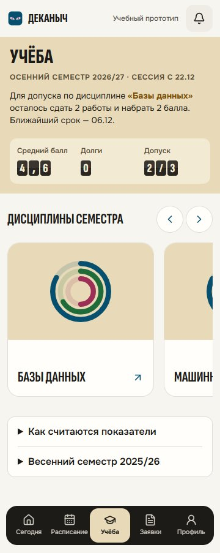
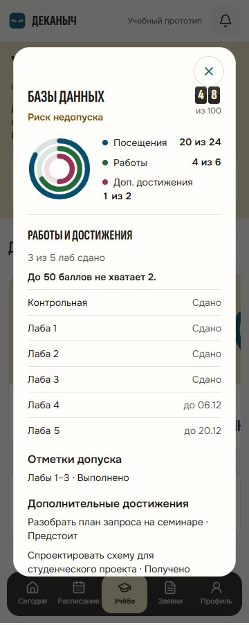
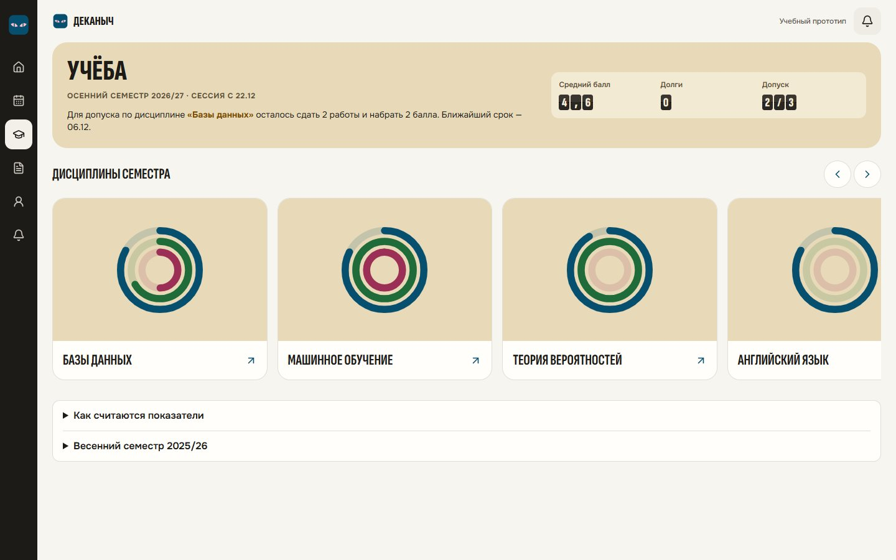

# Изменения Алёны объединены с доработками кабинета и запущены локально

- **Дата и время:** 2026-11-21 23:09 МСК
- **Инструмент:** Codex (напарник)
- **Кто ставил задачу:** напарник
- **Этап плана:** 6 Проверка
- **Требования PRD:** G1, G2, G3, NF1

## Задача

> Посмотри, какие изменения только что внесла Алёна. Запусти.

## Что сделал ИИ

- Проверил [PR #83](https://github.com/ghsteee/VIREA_Decanat/pull/83), автора и объединение в main: коммит `674aa49`, 21 ноября 22:35 МСК. Добавлены карусель дисциплин, три персональных кольца, подробности в диалоге, таблицы посещений и достижений, миграция и тест.
- Объединил main с веткой `fix/nf1-cabinet-polish` для [PR #81](https://github.com/ghsteee/VIREA_Decanat/pull/81). Разрешил конфликты в странице «Учёба», общих стилях, контексте и статусе. Сохранены новая карусель, северное сияние, полные названия дисциплин и остальные правки пользователя.
- Обновил Prisma-клиент, собрал production-версию и запустил её на `http://localhost:3000`. Перед миграцией локальной базы создана резервная копия. Старые данные не сбрасывались; вымышленные отметки и цели добавлены только в новые таблицы по образцу seed Алёны.
- ESLint, сборка с проверкой типов и 18 модульных тестов прошли. Браузером на 360 и 1440 px проверены карусель, диалог, личные достижения, Escape, возврат фокуса и отсутствие горизонтального переполнения.
- Все 30 браузерных тестов объединённой версии прошли на отдельной временной базе, включая сценарий Алёны и адаптацию 320–1920 px.
- Для публичного VPS миграцию нужно применять отдельно при выкладке. Этот запуск относится к локальному приложению.

## Что проверил и поправил человек

Пользователь попросил запустить изменения после просмотра. Просмотр объединённого интерфейса человеком предстоит; визуальный владелец — Алёна.

## Ошибки ИИ

Сборка была начата при работающем standalone-сервере: Windows удерживала файлы предыдущей сборки. После остановки только нашего старого процесса упаковка продолжилась. Перед следующей production-сборкой останавливать локальный standalone-сервер.

## Скриншоты

