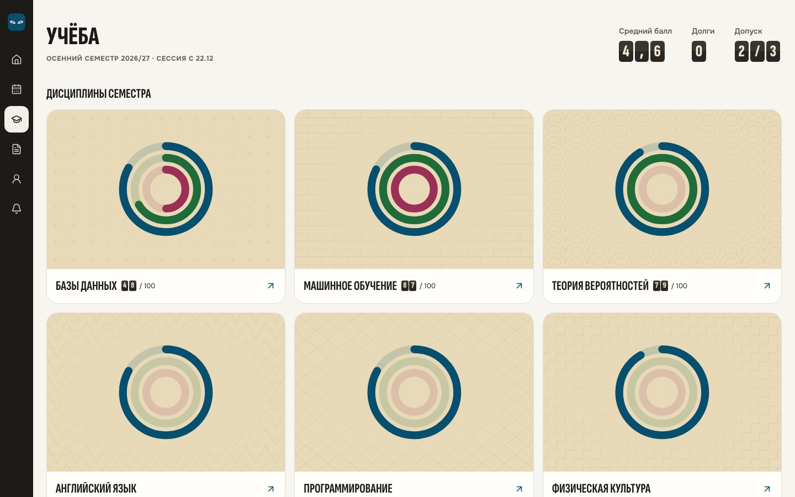
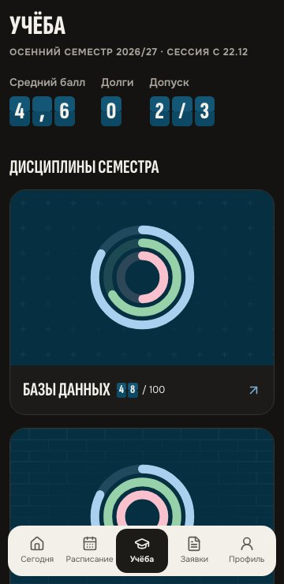

# Геометрические узоры на обложках дисциплин

- **Дата и время:** 2026-11-21 23:10 МСК
- **Инструмент:** Codex (Алёна)
- **Кто ставил задачу:** Алёна
- **Этап плана:** 6 Проверка
- **Требования PRD:** G3, NF1

## Задача

«Сделай карточки как было, но в сетке. Вместо выделения цветом добавь выделение бледными-бледными геометрическими узорами».

## Что сделал ИИ

Вернул пропорции обложки 3:2, крупные кольца по центру и отдельную нижнюю полосу с названием, баллом и стрелкой. В светлой теме обложки песочные, в тёмной — тёмно-синие. Шесть геометрических узоров нарисованы тонкими линиями и затихают к центру обложки. Рисунок остаётся у предмета при пересортировке по статусу допуска. Сохранена прокрутка страницы.

## Что проверил и поправил человек

Алёна сравнила предыдущую версию со снимком исходной карточки и выбрала его как образец.

## Ошибки ИИ

В прошлой версии вместе с раскладкой изменились пропорции карточки, положение стрелки и фоны. По замечанию Алёны восстановлена исходная композиция во всей сетке.

## Скриншоты

