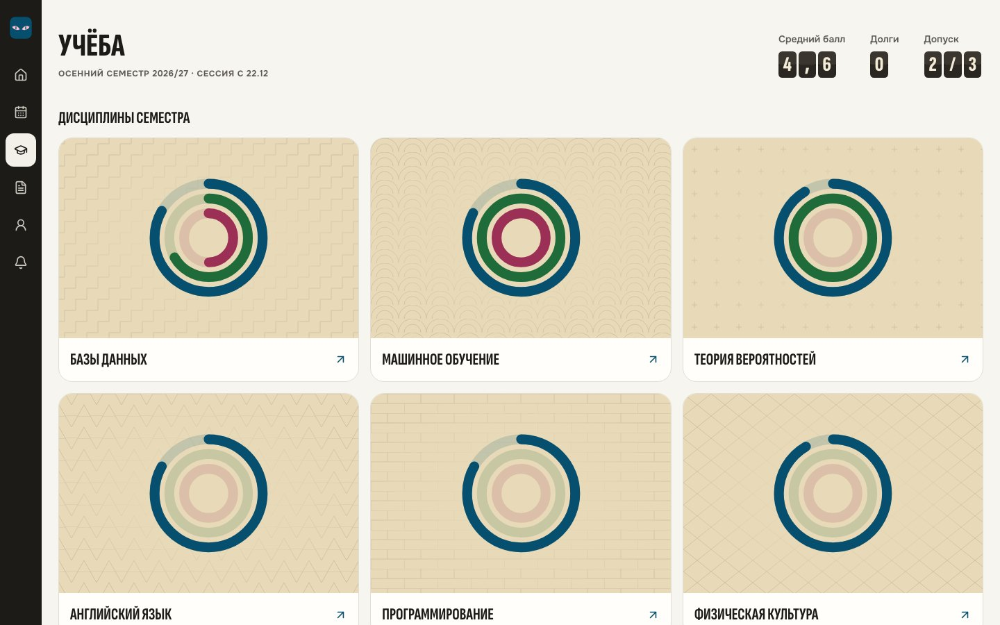
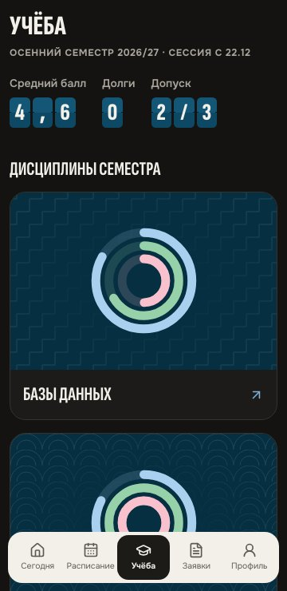

# Подписи и узоры карточек дисциплин

- **Дата и время:** 2026-11-21 23:13 МСК
- **Инструмент:** Codex (Алёна)
- **Кто ставил задачу:** Алёна
- **Этап плана:** 6 Проверка
- **Требования PRD:** G3, NF1

## Задача

«Убери вот эти баллы около названий и попробуй сделать узор чуть-чуть более видимым».

## Что сделал ИИ

Убрал рейтинг из подписи в сетке. Нажатие на предмет открывает подробности с баллом из 100. Непрозрачность геометрических узоров увеличена с 8% до 12%.

## Что проверил и поправил человек

Алёна указала на балл в нижней полосе карточки и попросила усилить рисунок обложки.

## Ошибки ИИ

Не было.

## Скриншоты

