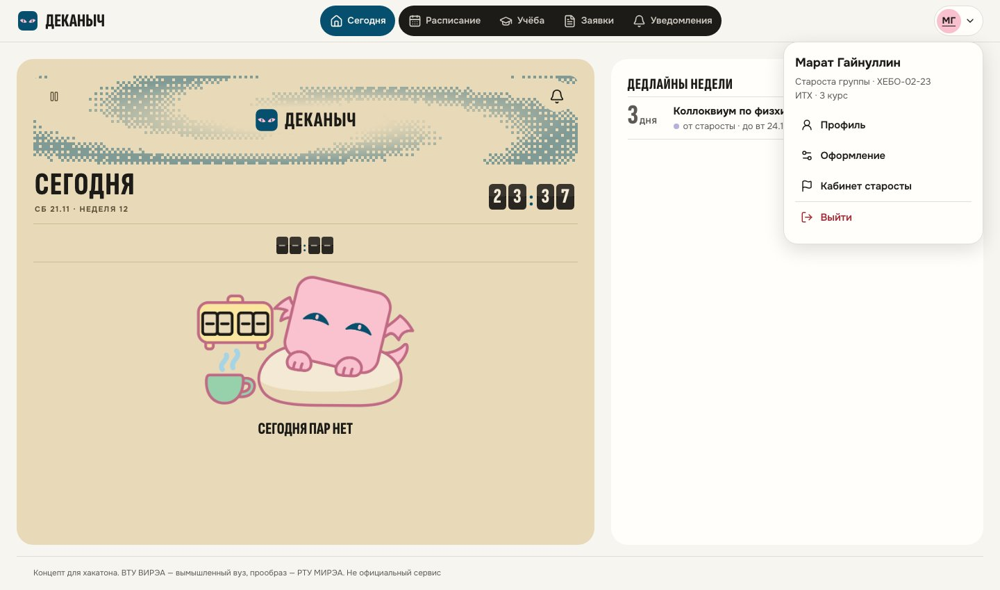
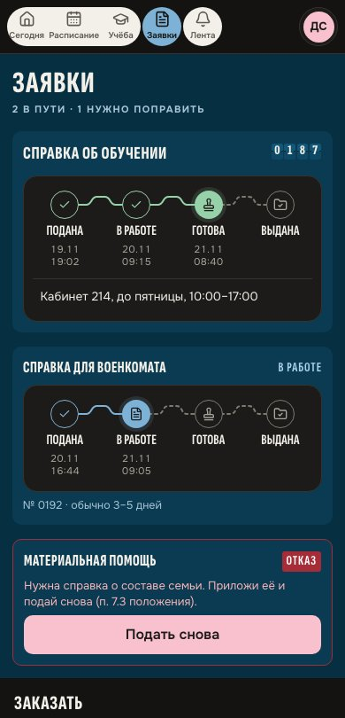
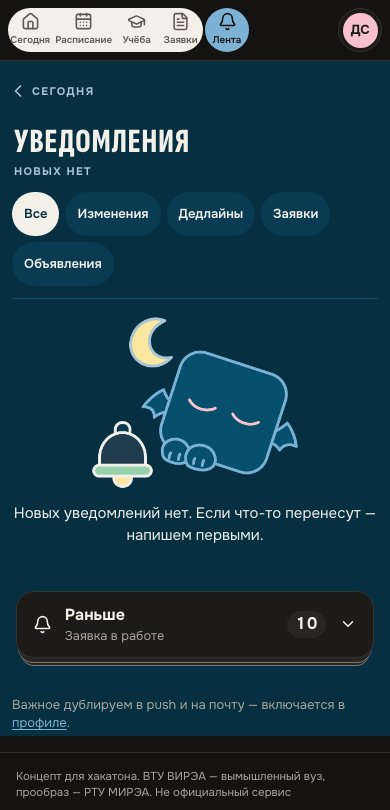

# Верхняя навигация, профиль, оформление и карточки статусов

- **Дата и время:** 2026-11-21 23:37 МСК
- **Инструмент:** Codex (Алёна)
- **Кто ставил задачу:** Алёна
- **Этап плана:** 6 Проверка
- **Требования PRD:** A4, N1, NF1, NF3

## Задача

Алёна выбрала пять образцов Kokonut UI и попросила адаптировать их к профилю, заявкам, оформлению, навигации и истории уведомлений кабинета.

## Что сделал ИИ

- Верхняя навигация учитывает роль и открытый раздел. Меню аккаунта показывает данные текущего пользователя и доступные ему действия. [Split Nav](https://kokonutui.com/docs/navigation/morphic-navbar) и [Account Menu](https://kokonutui.com/docs/navigation/profile-dropdown).
- В профиле тема меняется круговым переходом от кнопки и сохраняется в настройках пользователя. Системная тема следует настройке устройства. [Switch Button](https://kokonutui.com/docs/buttons/switch-button).
- На маршруте заявки отмечены этапы, даты событий и указания для получения. Для отказа сохранена причина и возможность повторной подачи. [AI Order Status](https://kokonutui.com/docs/ai/ai-order-status).
- Стопка в карточке ленты показывает заголовок последнего прочитанного уведомления и количество сообщений для выбранного фильтра. Стопка раскрывается мышью, касанием и клавиатурой. [Notification Stack](https://kokonutui.com/docs/cards/notification-stack).

Локально прошли 19 сквозных и 10 модульных тестов. В Chromium и WebKit дополнительно проверены меню трёх ролей, выбор и сохранение темы, история заявок и раскрытие стопки.

## Что проверил и поправил человек

Алёна прислала ссылки и уточнила расположение навигации и истории уведомлений. Просмотр реализации предстоит.

## Ошибки ИИ

Первый снимок меню пришёлся на начало анимации. Для журнала снято полностью раскрытое состояние.

## Скриншоты

