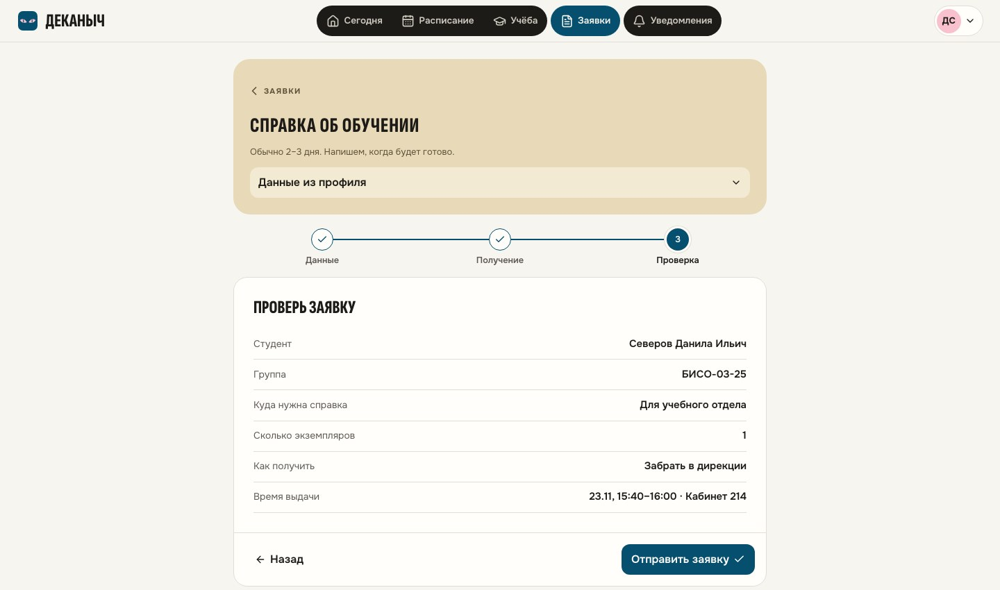
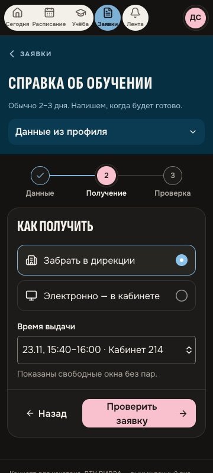

# Пошаговое оформление заявки в дирекцию

- **Дата и время:** 2026-11-21 23:43 МСК
- **Инструмент:** Codex (Алёна)
- **Кто ставил задачу:** Алёна
- **Этап плана:** 6 Проверка
- **Требования PRD:** A1, A2, A3, A4, NF1

## Задача

«Для создания новой заявки идея такая, адаптируй под наши нужды». Вложение иллюстрирует шаги формы, переходы, индикатор прогресса и проверку заполнения.

## Что сделал ИИ

Форма загружает поля, доступные для выбранного типа заявки. Студент может вернуться к пройденному шагу с сохранением ответов. При получении в дирекции можно выбрать свободное окно или согласовать время позже. Для исключительно электронных заявок сразу после ввода открывается проверка. Итоговая карточка показывает сведения из профиля, введённые значения и выбранный способ получения. Отправка создаёт заявку через существующее действие на сервере.

При повторной подаче форма подставляет данные отклонённой заявки. Если выбранное окно перестало быть доступным, форма возвращает к получению и обновляет список окон.

Проверены все шесть типов заявок на компьютере в Chromium и при ширине 360 px в WebKit. На временной базе проверены повторное заполнение после отказа, возврат после потери окна выдачи и сохранение введённых данных. Полный прогон проекта прошёл 19 сквозных тестов.

## Что проверил и поправил человек

Алёна выбрала пример взаимодействия. Новый экран ожидает её просмотра.

## Ошибки ИИ

Первый вариант оставлял на компьютере большую пустую панель рядом с формой. После просмотра шага проверки форма собрана в одну колонку.

## Скриншоты

