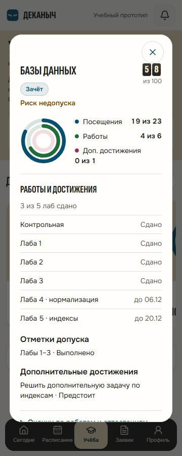
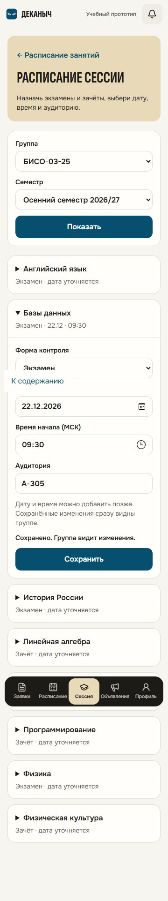
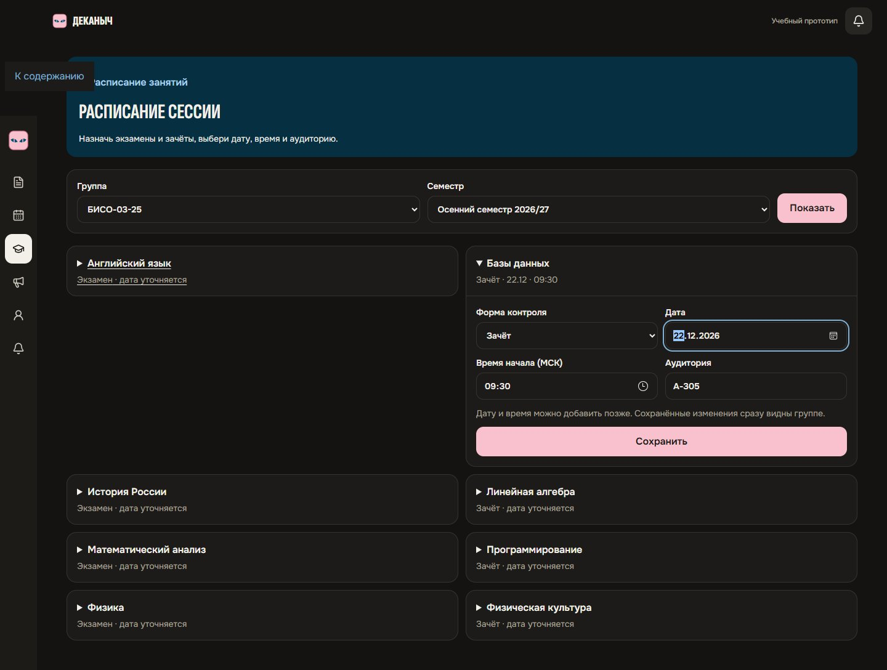
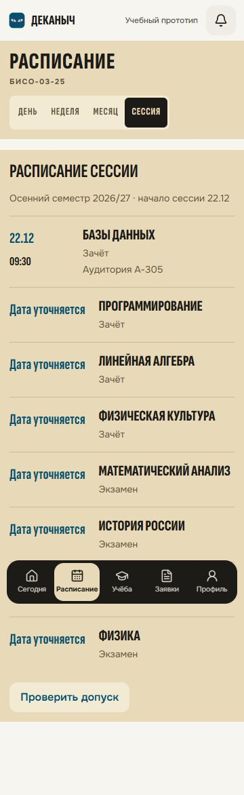

# Формы контроля внутри предметов и редактор сессии для дирекции

- **Дата и время:** 2026-11-21 23:52 МСК
- **Инструмент:** Codex (напарник)
- **Кто ставил задачу:** напарник
- **Этап плана:** 4 Must, 6 Проверка
- **Требования PRD:** G1, E2, NF1

## Задача

> Пометить экзамены и зачёты внутри предмета. Распределить формы контроля самостоятельно в демо. Дирекции добавить назначение формы контроля и составление расписания сессии.

## Что сделал ИИ

- Метки «Экзамен» и «Зачёт» находятся только в подробностях предмета. Выборка ограничена группой студента и текущим семестром; повторные аттестации не дублируют метку. Для неизвестной формы есть явное пояснение.
- Добавлен `/staff/session`: выбор доступной группы и семестра, назначение и редактирование формы контроля, даты, времени по Москве и аудитории. Дата необязательна. Сохранение сразу отражается в студенческом расписании сессии.
- Сервер берёт сотрудника из сессии и проверяет назначенные институты, группу, дисциплину и событие. Чужие идентификаторы возвращают 404. Проверяются дата, время, совпадение начала у группы и версия записи. Для события с результатами нельзя менять форму контроля.
- В `Assessment` добавлены `sessionStartsAt`, `sessionRoom`, `sessionVersion`. Миграция не сбрасывает данные. Демонстрационный seed чередует экзамены и зачёты по дисциплинам группы; даты заранее не назначает. Подробности в `docs/data-model.md` и `docs/setup/deploy.md`.
- В локальной базе применена миграция с резервной копией, добавлены только отсутствовавшие формы контроля. Приложение запущено на `localhost:3000`.
- Прошли production-сборка с TypeScript, ESLint и 18 модульных тестов. Проведён общий прогон 34 браузерных сценариев. После визуальной проверки и исправления нативного сброса повторно прошли все 5 сценариев сессии и учёбы, включая точное значение выбранной формы после сохранения. Проверены 360 и 1440 px; общий адаптивный прогон — 320–1920 px.

## Что проверил и поправил человек

Пользователь разрешил произвольное распределение форм в вымышленном демо и уточнил, что метки нужны только внутри предмета. Просмотр готового интерфейса человеком предстоит. Визуальное ревью — Алёна.

## Ошибки ИИ

- Тест искал select через точный текст вложенного label и ожидал заголовок «404». Исправлено на доступное имя combobox и фактический заголовок «Страница не найдена». Проверять имена элементов по дереву доступности.
- Автоматический reset после server action сбрасывал новые поля; управляемые значения устранили блокировку повторного сохранения, но select продолжал визуально возвращаться к исходному option. Это обнаружено на снимке и подтверждено отдельной проверкой. Нативный обработчик reset сохраняет значения; тест теперь проверяет не только БД, но и выбранный пункт.
- После перехода к управляемым полям React отменял подмену hidden-полей в тесте до отправки. Тест подменяет FormData непосредственно при сериализации; чужая группа и событие подтверждённо недоступны.

## Скриншоты

