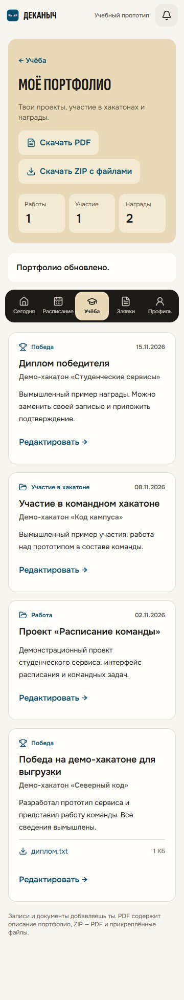
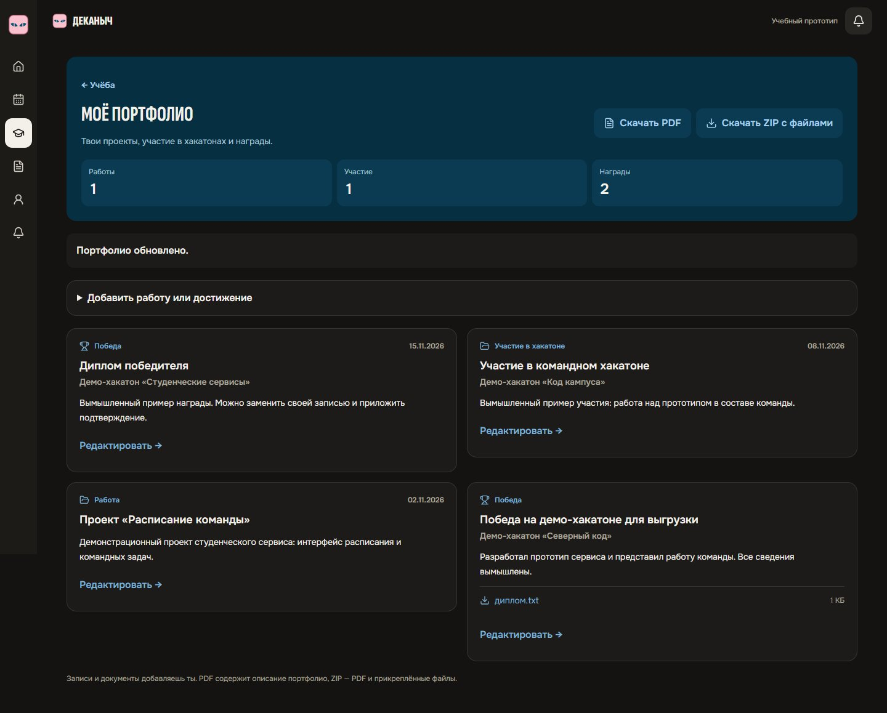
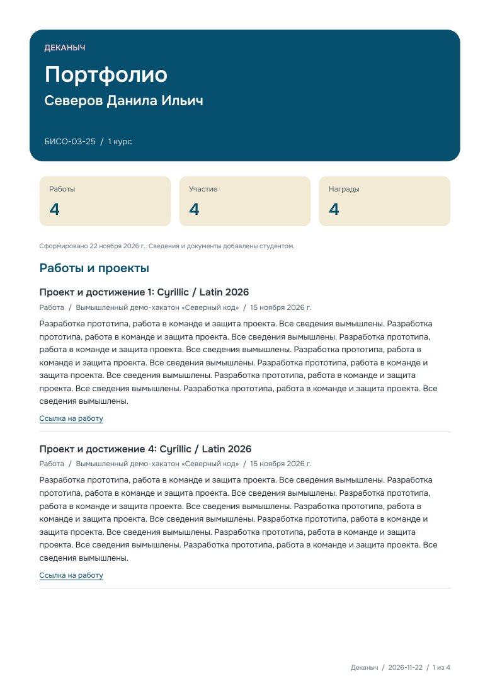
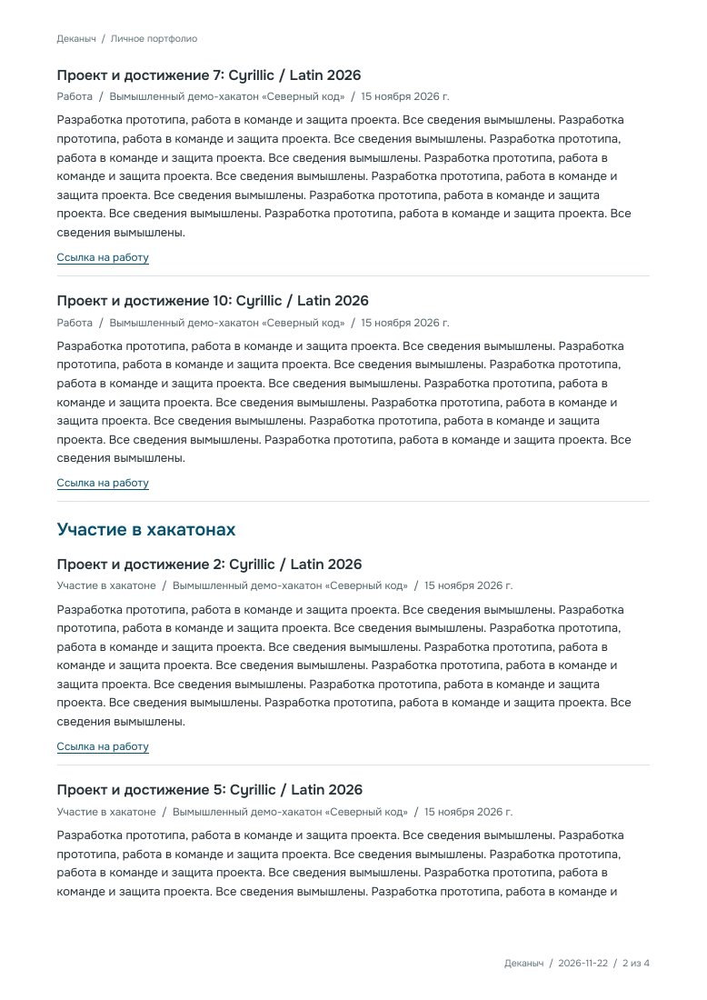

# Личное портфолио с работами, наградами, PDF и ZIP

- **Дата и время:** 2026-11-22 00:25 МСК
- **Инструмент:** Codex (напарник)
- **Кто ставил задачу:** напарник
- **Этап плана:** 5 Should, 6 Проверка
- **Требования PRD:** G4, NF1, NF6

## Задача

> Добавь выгрузку личных достижений студента: портфолио с работами и наградами за участие и победы в хакатонах. PDF и архив приложенных файлов.

## Что сделал ИИ

- Добавлен раздел `/study/portfolio` из «Учёбы»: работы, участие, победы и призовые места; название, описание, мероприятие, дата, ссылка. Можно создавать, редактировать и удалять записи и вложения. В демо только вымышленные примеры.
- Вложения хранятся вне `public` под случайными UUID; скачиваются только владельцем из серверной сессии. Проверяются тип, сигнатура и размер: до 5 файлов по 5 МБ на запись, до 50 МБ и 50 записей на студента. В базе — метаданные, в Compose — постоянный том `portfolio-data`.
- PDF с локальными Onest содержит сведения о студенте, работы и достижения. ZIP включает PDF и исходные вложения с безопасными именами. Экспорт ограничен владельцем и частотой запросов, ответы не кешируются.
- Добавлены модели `PortfolioItem`, `PortfolioAttachment` и миграция. Данные локальной базы сохранены, перед миграцией создана резервная копия. Обновлены PRD (G4), лицензии, модель данных и инструкция выкладки.
- Для PDF использован навык `pdf`: [PDFKit](https://pdfkit.org/docs/text.html), локальные TTF Onest с SIL OFL; ZIP — [fflate](https://github.com/101arrowz/fflate). Внешние сервисы при выгрузке не вызываются.
- Production-сборка и TypeScript прошли. Три браузерных сценария проверили весь CRUD с файлом, PDF/ZIP, отказ неподходящему и большому файлу, HTTP 404 чужой страницы/вложения, подмену идентификатора непосредственно в HTTP-запросе и изоляцию экспорта. Отдельно повторены сценарии сессии и учёбы при разработке.
- Просмотрены интерфейсы на 360 и 1440 px. Четырёхстраничный образец PDF с длинными описаниями отрендерен Poppler; все страницы просмотрены, кириллица и латиница проверены извлечением текста. Реальный PDF из маршрута выгрузки также проверен.

## Что проверил и поправил человек

Пользователь подтвердил PDF и архив вложенных файлов и попросил ускорить работу. Готовый интерфейс и файлы человеку предстоит посмотреть. Визуальное ревью — Алёна.

## Ошибки ИИ

- Пустой файловый input воспринимался как новое пустое вложение и мешал редактированию без загрузки. Браузерный сценарий поймал ошибку; пустые части multipart пропускаются.
- Родительский `study/loading.tsx` начинал поток с HTTP 200 до проверки чужого id. Учебный обзор и его загрузка перенесены в `(overview)`, URL `/study` сохранён; чужая страница портфолио теперь отвечает именно 404.
- Селекторы теста учитывали текст textarea как часть label и находили служебный alert Next.js. Использованы доступная роль textbox и alert внутри main. Подмена скрытого React-поля заменена подменой реально отправляемого HTTP-тела.
- Первоначальный заголовок PDF при добавлении страницы менял шрифт продолжающегося абзаца. Заголовки и номера страниц теперь рисуются после основного текста; длинный документ проверен на четырёх страницах.
- Уточнены тип enum при записи и атрибут download у ссылок выгрузки по ошибкам TypeScript/ESLint. Проверочный скрипт PDF адаптирован к CJS и серверным импортам, временный pypdf установлен только в `tmp`.

## Скриншоты

