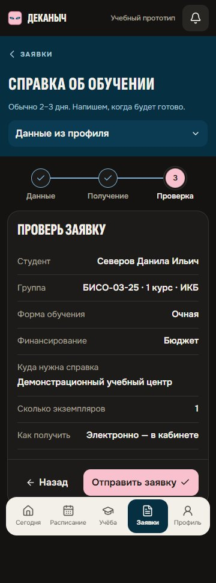
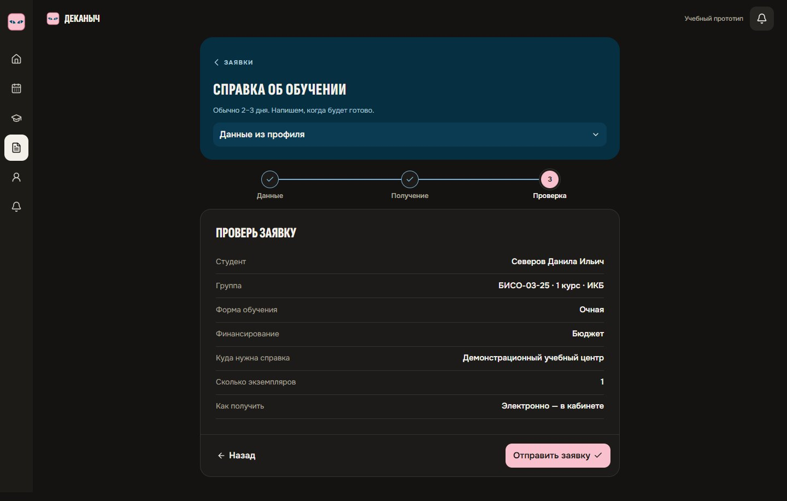
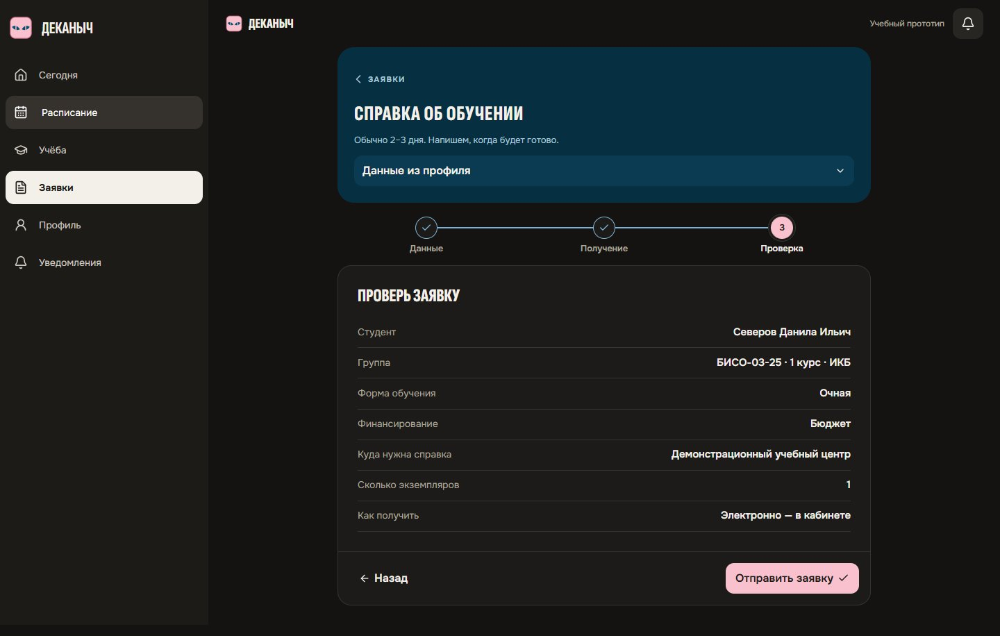

# Прежнее меню, пошаговая заявка и команды обновления с Mac

- **Дата и время:** 2026-11-22 12:57 МСК
- **Инструмент:** Codex (напарник)
- **Кто ставил задачу:** напарник
- **Этап плана:** 6 Проверка, 7 Сдача
- **Требования PRD:** A1, A2, A3, A4, G1, NF1, N1

## Задача

> В №85 откатить изменение навигации, остальное слить. Адаптировать карточку создания заявки из вложенного примера. Подготовить команды для выкладки из терминала Mac.

## Что сделал ИИ

- Синхронизировал [PR #81](https://github.com/ghsteee/VIREA_Decanat/pull/81) с `main`, где уже были №84, №85 и №88. Разрешил конфликты. Восстановил мобильную нижнюю капсулу и раскрывающуюся боковую панель, включая пункт «Сессия» у дирекции. Сохранил смену темы, маршрут заявки, раскрываемую историю уведомлений, сетку предметов, портфолио и расширенный seed.
- Использовал уже реализованную в №85 пошаговую форму по идее референса. Добавил группу, курс, институт, форму обучения и финансирование в сводку. Повторная подача извлекает только свою отклонённую заявку, повторно созданная версия открывается напрямую. Чужая ссылка возвращает HTTP 404.
- Команды [для Terminal на Mac](../../setup/deploy-from-mac.md) и сценарий `deploy/update-demo-with-migrations.sh` проверяют полный SHA `main`, собирают образы, делают резервную копию базы и вложений, применяют добавочные миграции и проверяют запуск. При сбое после остановки приложения сценарий возвращает предыдущий образ. Синтаксис Bash и порядок операций проверены на имитации серверных команд. Проверки GitHub запускаются также на `main` после слияния.
- Локальный интерфейс проверен на 360 и 1440 px. При перезапуске сохранена текущая база. Новые демоданные №88 проверены на отдельной базе. Пройдены сборка, линтер, проверка типов, 18 модульных и 38 браузерных тестов.

## Что проверил и поправил человек

Пользователь выбрал прежнюю навигацию и предоставил пример пошаговой формы. Визуальное ревью — Алёна. Выкладку на VPS пользователь выполняет сам после проверки `main`.

## Ошибки ИИ

- После объединения потерялся импорт короткой пометки прототипа на главной. TypeScript обнаружил ошибку, импорт восстановлен.
- Проверки требовали ровно один перерыв каждого типа, хотя №88 добавил пары. Проверку скорректировали под сохранение обоих типов перерывов.
- Тест настроек переключал тему до завершения сохранения, проверка ленты полагалась на неустойчивое наведение фокуса после перезагрузки, измерение кнопки отличалось от 44 px из-за округления. Проверены подтверждение сохранения, раскрытие и закрытие ленты и фактическая высота кнопки в раскладке.

## Скриншоты

