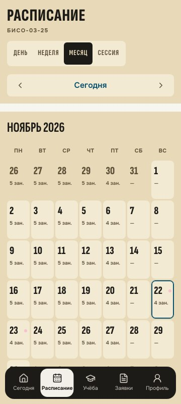

# Перенесены совместимые правки напарника

- **Дата и время:** 2026-11-22 13:47 МСК
- **Инструмент:** Codex (Алёна)
- **Кто ставил задачу:** Алёна
- **Этап плана:** 6 Проверка
- **Требования PRD:** R1, R2, P1, NF7

## Задача

После слияния поиска и нижней навигации перенести правки напарника, совместимые с текущей версией кабинета.

## Что сделал ИИ

Перенёс из №81 календарь на месяц, просмотр опубликованных экзаменов и зачётов группы, полные названия типов занятий и перерывы. Из №76 перенёс удаление QR-заглушки, из №72 — проверку связи с базой и проверку состояния контейнера приложения. Поиск, меню и пошаговая заявка остались в текущем виде. Изменений схемы базы нет.

## Что проверил и поправил человек

Проверка Алёной впереди.

## Ошибки ИИ

При переносе тест перерывов ожидал по одной вставке каждого типа. В расширенном расписании они могут повторяться. Тест проверяет наличие обоих типов и времена перерывов.

## Скриншоты

