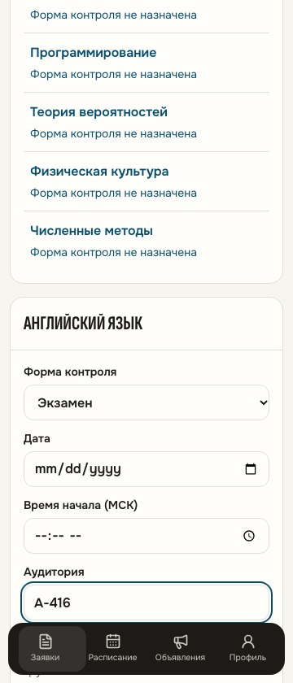

# Реализован редактор сессии дирекции

- **Дата и время:** 2026-11-22 14:15 МСК
- **Инструмент:** Codex (Алёна)
- **Кто ставил задачу:** Алёна
- **Этап плана:** 5 Should
- **Требования PRD:** E2, R1

## Задача

Сделать новый редактор сессии поверх текущего интерфейса.

## Что сделал ИИ

В расписании дирекции добавил переход в редактор. В нём выбираются группа, семестр и дисциплина. Можно назначить экзамен или зачёт, указать дату, время по Москве и аудиторию. Результат сразу отображается в расписании группы. Проверяются права на группу, прошлые версии записи, конфликт времени и смена типа аттестации с опубликованными результатами. Для полей времени, аудитории и версии нужна добавочная миграция.

На временной базе применил миграцию и проверил назначение экзамена, повторное редактирование аудитории, отображение у студента и закрытый для его роли редактор. Сборка и 25 браузерных тестов прошли.

## Что проверил и поправил человек

Проверка Алёной впереди.

## Ошибки ИИ

Не было.

## Скриншоты

