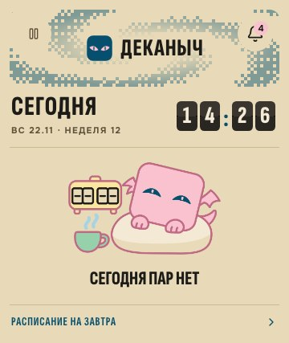

# Завтрашняя пара убрана с табло «Сегодня»

- **Дата и время:** 2026-11-22 14:24 МСК
- **Инструмент:** Codex (Алёна)
- **Кто ставил задачу:** Алёна
- **Этап плана:** 6 Проверка
- **Требования PRD:** T1, T2

## Задача

Исправить экран, который одновременно показывал занятие и сообщение «Сегодня пар нет».

## Что сделал ИИ

На табло выводится текущая или предстоящая пара сегодняшнего дня по Москве. Если пар больше нет, показывается состояние дня: расписание пустое, все занятия завершились или все пары отменены. Ссылка «Расписание на завтра» открывает следующий день отдельно.

Проверил сценарий с пустым днём и занятием на завтра на ширине 360 px. Все 28 браузерных тестов прошли.

## Что проверил и поправил человек

Алёна показала проблему на скриншоте. Проверка исправленной версии впереди.

## Ошибки ИИ

Экран использовал завтрашнюю пару как запасной вариант для сегодняшнего табло, а иллюстрацию выводил независимо по пустому списку за сегодня. Убрана подстановка следующего дня.

## Скриншоты

