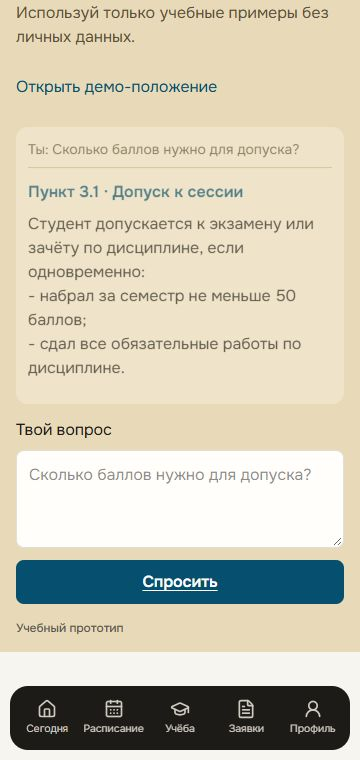

# Доработка помощника и согласование PR №81 с `main`

- **Дата и время:** 2026-11-22 17:38 МСК
- **Инструмент:** Codex (напарник)
- **Кто ставил задачу:** напарник
- **Этап плана:** 6 Проверка
- **Требования PRD:** AI1, AI2, AI3, NF1

## Задача

> Доделать ИИ-помощника и исправить 81 коммит, чтобы он не конфликтовал с главной веткой.

## Что сделал ИИ

- Объединил PR №81 с `main`, сохранив боковое меню на компьютере, анимацию нижнего меню, поиск по дисциплинам, редактор сессии и вложения портфолио. Схема и миграции в обеих ветках совпадают.
- Добавил поддержку сроков OAuth в секундах и миллисекундах. Некорректный ответ модели показывает сбой сервиса. Пустой список выбранных пунктов означает, что в положении ответа нет.
- Уточнил распознавание запросов на черновик справки. Вопрос о необходимости справки и отказ от черновика оставляют пользователя в диалоге. Поля заявки редактируются перед подтверждением отправки.
- Расширил [проверку подключения](../../setup/gigachat.md) запросом на генерацию и добавил пять контрольных вопросов для VPS.
- Сборка, ESLint, проверка типов и 23 модульных теста прошли. В браузере проверил четыре ссылки на пункты, вопрос за пределами положения, некорректный ответ модели и переход к редактируемому черновику. Для ответов использована локальная имитация GigaChat.

## Что проверил и поправил человек

Проверка ответов с ключом проекта на VPS и визуальное ревью Алёной предстоят.

## Ошибки ИИ

- В изолированной сборке Windows копирование зависимостей для standalone завершилось `EPERM`. Сборка прошла после запуска с доступом для копирования этих файлов.
- Тест поиска читал список до окончания загрузки «Учёбы». Добавил ожидание появления списка перед проверкой результатов.

## Скриншоты

