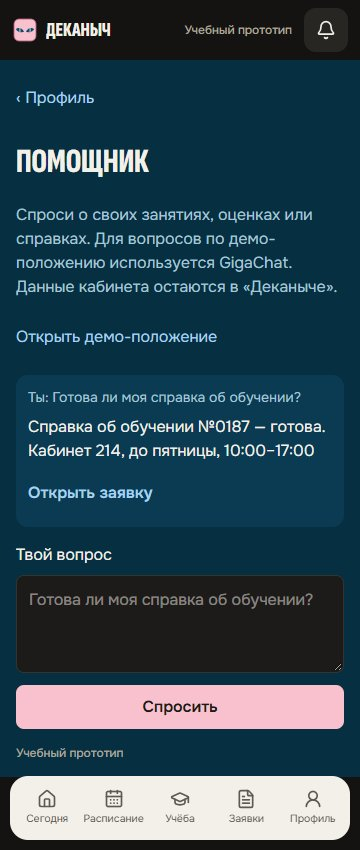

# Ответы помощника по данным кабинета студента

- **Дата и время:** 2026-11-22 18:00 МСК
- **Инструмент:** Codex (напарник)
- **Кто ставил задачу:** напарник
- **Этап плана:** 5 Should
- **Требования PRD:** AI1, AI2, AI3

## Задача

> Помощник должен отвечать об успеваемости, расписании студента и готовности его справок. Если ответа нет, писать, что ответ не найден.

## Что сделал ИИ

- Добавил ответы о парах, сессии, оценках, допуске, сроках и статусах заявок. Помощник показывает сведения из кабинета и ссылку на соответствующий раздел или свою заявку.
- Идентификаторы студента и группы берутся из серверной сессии. Вопросы о личном кабинете обрабатываются на сервере приложения. Сохранены ссылки на демо-положение, редактируемые черновики и лимит 20 запросов в час.
- Проверил личные ответы на 360 px, переход к своей справке и отказ по номеру чужой заявки. Проверил публичные ответы по демо-положению с локальной имитацией GigaChat. Обновил локальный сайт на существующей демобазе.

## Что проверил и поправил человек

Результат доступен для проверки в локальном кабинете. Живой GigaChat требует ключа проекта.

## Ошибки ИИ

Не было.

## Скриншоты

