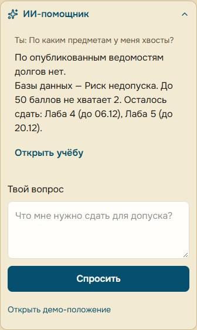

# Ответы о допуске и форма помощника на «Сегодня»

- **Дата и время:** 2026-11-22 18:10 МСК
- **Инструмент:** Codex (напарник)
- **Кто ставил задачу:** напарник
- **Этап плана:** 6 Проверка
- **Требования PRD:** AI1, AI3, NF1

## Задача

> Помощник на многие вопросы о долгах и допусках отвечает, что ответа нет. Добавить его и на страницу «Сегодня».

## Что сделал ИИ

- Добавил распространённые формулировки про хвосты, условия допуска и несданные работы. Личный ответ показывает официальный статус, риск недопуска, недостающие баллы и работы со сроками.
- Общие условия допуска и пересдачи открываются из опубликованных пунктов демо-положения без ключа GigaChat.
- Добавил раскрывающуюся форму сразу под заголовком «Сегодня». Сохранил вход в помощник из профиля.
- Проверил сборку, модульные тесты, ответы и ссылки на 360 px. Перезапустил `localhost:3000` на существующей базе.

## Что проверил и поправил человек

Пользователь указал на ложные ответы «Ответ не найден» по учебным вопросам. Обновлённые ответы доступны для проверки в локальном кабинете.

## Ошибки ИИ

- В предыдущей версии общие вопросы об условиях допуска зависели от наличия ключа GigaChat, а часть разговорных формулировок не попадала в обработчик «Учёбы». Добавил проверяемые примеры в браузерный сценарий.
- В первом полном прогоне дополнительный демовход совпал с отказом последней проверки входа. Объединил проверки помощника под одной сессией и запустил повторный прогон.

## Скриншоты

