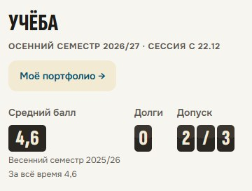

# Расчёт и отображение среднего балла

- **Дата и время:** 2026-11-22 18:21 МСК
- **Инструмент:** Codex (напарник)
- **Кто ставил задачу:** напарник
- **Этап плана:** 6 Проверка
- **Требования PRD:** G2, AI1

## Задача

> Некорректно отображается средний балл.
> Средний балл единой плашкой выводи.

## Что сделал ИИ

- В расчёте участвуют опубликованные оценки за экзамены закрытых сессий по московской дате. Пять оценок Ксении за последнюю сессию дают 4,6. В тесте дополнительная оценка 2 за экзамен в более раннем семестре меняет общий средний до 4,2. Лабораторная и пустая оценка на результат не влияют.
- Разместил отдельные значения за последнюю закрытую сессию и за всё время. После уточнения пользователя отобразил число за последнюю сессию единым блоком вместе с запятой. Помощник использует те же данные для вопроса о средней оценке за последнюю сессию.
- Прошли сборка, 24 модульных и пять браузерных тестов. Обновил локальный сайт на прежней базе.

## Что проверил и поправил человек

Пользователь сообщил о некорректном среднем. Исправленный расчёт доступен для проверки локально.

## Ошибки ИИ

В старом запросе выборка зависела от пятибалльной шкалы и не проверяла вид работы. Пустые значения учитывались как ноль. Тест проверяет оба случая и два периода отдельно.

## Скриншоты

